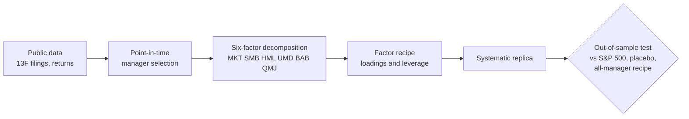

# TiresIAs

**Reverse-engineering the factor recipes of top investors into systematic rules, evaluated out of sample under
pre-registered criteria.**

[](LICENSE)


TiresIAs asks whether the returns of investors with long, public track records can be decomposed into known factor
exposures and leverage, and whether a systematic rule built from that decomposition keeps beating the S&P 500 after
the period in which it was discovered. Every hypothesis, threshold and test is committed to this repository before the
data that decides it is downloaded; the commit history is the audit trail.

Detailed plans and results are written in Spanish (`docs/`); this page summarises them.

---

## Results to date

| Phase | Question | Outcome |
|---|---|---|
| **1** | Does Kronos, a foundation model for candlestick data, forecast anything useful after its training cut-off and net of costs? | **No.** 0 of 5 pre-registered tests pass; smallest *p* = 0.105 against a Holm threshold of 0.01. Retrained with the authors' own pipeline (U4), its portfolio Sharpe is 0.84, below the placebo 95th percentile of 1.25. [Results](docs/RESULTADOS_RONDA2.md) |
| **2A** | Can Table 4 of *Buffett's Alpha* (Frazzini, Kabiller & Pedersen, 2018) be reproduced with public data? | **Yes, 3 of 3 criteria.** BAB loading 0.29 (published 0.29), QMJ 0.47 (0.43); the annualised alpha falls from 10.0 % (*t* = 2.68) with four factors to 4.0 % (*t* = 1.02) with six. HML is at the edge of tolerance (0.31 vs 0.46). [Results](docs/RESULTADOS_FASE2A.md) |
| **2A′** | Does the systematic Buffett-style strategy survive publication? | **No, 2 of 3 criteria.** With parameters frozen on 1980–2011, its Sharpe ratio exceeds the market's by +0.65 in 2012–2019 but trails it by −0.05 in 2019–2026. Over 2012–2026 Berkshire Hathaway itself trails the market (0.77 vs 0.94). [Results](docs/RESULTADOS_FASE2A.md#2a-sigue-viva-la-receta-después-de-publicarse-no-2-de-3) |
| **2B** | Does the factor recipe of top 13F filers, selected point-in-time, beat the S&P 500, a placebo and the recipe of all filers? | In progress |
| **2C** | Does it survive implementation with investable long-only ETFs, costs and taxes? | Only if 2B passes |

### Phase 2A — Table 4 replication

Monthly excess returns of BRK-A, April 1980 – December 2011 (381 months; the paper uses CRSP from November 1976).
Coefficients with *t*-statistics in parentheses; published values in brackets.

| | (1) MKT, SMB, HML, UMD | (2) + BAB | (3) + BAB + QMJ |
|---|---|---|---|
| Alpha (annualised) | 10.0 % (2.68) [12.1 %] | 7.9 % (2.02) [9.2 %] | 4.0 % (1.02) [6.3 %] |
| MKT | 0.79 (10.96) [0.84] | 0.79 (11.28) [0.83] | 0.92 (10.60) [0.95] |
| SMB | −0.38 (−3.67) [−0.32] | −0.40 (−3.90) [−0.32] | −0.24 (−2.05) [−0.15] |
| HML | 0.41 (3.66) [0.63] | 0.19 (1.55) [0.38] | 0.31 (2.36) [0.46] |
| UMD | 0.04 (0.64) [0.06] | −0.04 (−0.63) [−0.03] | −0.09 (−1.21) [−0.05] |
| BAB | | 0.35 (3.96) [0.37] | 0.29 (3.24) [0.29] |
| QMJ | | | 0.47 (2.46) [0.43] |
| Adj. R² | 0.25 [0.25] | 0.28 [0.27] | 0.29 [0.28] |

Negative control: lagging the Berkshire series by one month yields QMJ 0.00 and MKT 0.17, and the replication test
fails 0 of 3.

### Phase 2A′ — the systematic strategy after publication

Construction of Section 7 of the paper (market beta, plus a factor-mimicking active component rescaled to Berkshire's
idiosyncratic volatility), with all parameters estimated on 1980–2011 and frozen. Annualised Sharpe ratios of excess
returns:

| Period | Systematic strategy | Berkshire | Market |
|---|---|---|---|
| 1980–2011, in sample | 1.15 (paper: 1.14) | 0.72 | 0.45 |
| 2012-01 – 2026-08 | 1.10 | 0.77 | 0.94 |
| 2012-01 – 2019-04 | 1.90 | 1.14 | 1.25 |
| 2019-05 – 2026-08 | 0.71 | 0.55 | 0.76 |

The strategy is a levered combination of long-short factors before costs and is not directly investable; the paper's
long-only version had an in-sample Sharpe ratio of 0.45 against 0.39 for the market (its Table 2).

## Approach



- **Replication first.** A published result is reproduced, as its authors computed it, before it is extended; the
  replication has explicit pass/fail tolerances and a negative control.
- **Pre-registration.** Questions, thresholds and test statistics are committed before the deciding data are
  downloaded ([phase 1 plan](docs/PLAN_UTILIDAD.md), [phase 2 plan](docs/PLAN_FASE2.md), commit `ac57fb5`).
- **No look-ahead.** Parameters are estimated only on data available at each date; 13F portfolios are formed on the
  filing date, never on the quarter end.
- **Placebos and multiple testing.** Each effect is compared with the same procedure applied where it cannot work
  (random managers, shuffled dates), and families of tests are corrected (Holm).
- **Copy the recipe, not the positions.** Copying disclosed holdings has a poor out-of-sample record: the Global X Guru
  ETF, which replicates top hedge-fund 13F positions, returned 5.9 % a year against 10.8 % for the S&P 500 over the last
  ten years ([PortfoliosLab](https://portfolioslab.com/tools/stock-comparison/GURU/SPY)).

## Limitations

- Factor returns (Ken French, AQR) are long-short and gross of costs. AQR rebuilds the full history of BAB and QMJ at
  each update, so the post-2012 test uses today's series.
- The public BRK-A series starts in 1980, four years after the paper's sample.
- *t*-statistics use classical OLS standard errors, as in the paper's Table 4, with no autocorrelation correction.
- The 2A′ out-of-sample window (181 months) is short relative to factor cycles, and one sub-period decides the verdict.

## Reproducing

```bash
python3.12 -m venv ~/.venvs/tiresias && source ~/.venvs/tiresias/bin/activate
pip install -r requirements.txt
python -m pytest tests            # 115 tests (at the repository root, pytest would also collect finetune/, which needs qlib)
python -m tiresias.buffett        # phases 2A and 2A′
```

No data are stored in the repository. `tiresias.buffett` expects, in `~/tiresias_datos/fase2/crudo`:

| File | Source |
|---|---|
| `F-F_Research_Data_Factors.csv`, `F-F_Momentum_Factor.csv` | [Kenneth R. French Data Library](https://mba.tuck.dartmouth.edu/pages/faculty/ken.french/data_library.html) |
| `Betting-Against-Beta-Equity-Factors-Monthly.xlsx`, `Quality-Minus-Junk-Factors-Monthly.xlsx` | [AQR Data Sets](https://www.aqr.com/Insights/Datasets) |
| `BRK-A_1d.json` | Yahoo Finance chart API, daily, from 1980-03-17 |

Outputs (aggregates only) are written to `~/tiresias_resultados/fase2/`.

## Repository layout

```
tiresias/      research code (phase 1: Kronos evaluation; phase 2: buffett.py)
tests/         unit tests (mutation-checked) and model regression tests
docs/          pre-registered plans and results (Spanish)
exploratorio/  exploratory work outside any pre-registered criterion
model/  finetune/  finetune_csv/  examples/  webui/    Kronos code (MIT), kept to reproduce phase 1
```

## References

- Frazzini, A., Kabiller, D., & Pedersen, L. H. (2018). Buffett's Alpha. *Financial Analysts Journal*, 74(4), 35–55.
  Working paper: NBER w19681 (2013).
- Frazzini, A., & Pedersen, L. H. (2014). Betting Against Beta. *Journal of Financial Economics*, 111(1), 1–25.
- Asness, C. S., Frazzini, A., & Pedersen, L. H. (2019). Quality Minus Junk. *Review of Accounting Studies*, 24(1),
  34–112.
- Cohen, R. B., Polk, C., & Silli, B. (2010). Best Ideas. Working paper, London School of Economics.
- McLean, R. D., & Pontiff, J. (2016). Does Academic Research Destroy Stock Return Predictability? *Journal of
  Finance*, 71(1), 5–32.
- Kronos: A Foundation Model for the Language of Financial Markets (2025). arXiv:2508.02739.

## Origin and licence

TiresIAs began in October 2026 as a fork of [Kronos](https://github.com/shiyu-coder/Kronos) to evaluate it (phase 1)
and has since become an independent project. The Kronos code is retained under its MIT licence so that phase 1 remains
reproducible; its original README is in [docs/ORIGEN_KRONOS.md](docs/ORIGEN_KRONOS.md). TiresIAs is released under the
MIT licence ([LICENSE](LICENSE)).

## Citation

```bibtex
@software{tiresias2026,
  title  = {TiresIAs: reverse-engineering investor factor recipes under pre-registered criteria},
  author = {cedarcreeks},
  year   = {2026},
  url    = {https://github.com/cedarcreeks/TiresIAs}
}
```

*Research only; nothing here is investment advice.*
