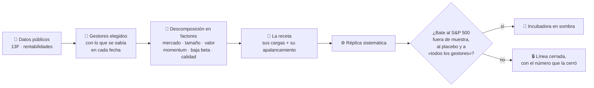

<div align="center">

# 🔮 TiresIAs

### Ingeniería inversa de los mejores inversores, con cada resultado pre-registrado

*Reverse-engineering top investors into systematic rules — every criterion written before the data. (Docs in Spanish.)*


-cerrada:_no_aporta-lightgrey?style=flat-square)


</div>

> Tiresias, el adivino ciego de Tebas, veía lo que los demás no. Aquí la ceguera es a propósito: **cada criterio se
> escribe y se commitea antes de ver el dato que decide**, y un «no» medido cuenta tanto como un «sí».

---

## La idea en una frase

Los inversores que baten al mercado durante décadas dejan rastro público: sus carteras trimestrales (formularios 13F de
la SEC) y su rentabilidad. TiresIAs no copia sus posiciones —eso ya se ha hecho, y fue mal—, sino **su receta**: a qué
factores se exponen y con cuánto apalancamiento. Y comprueba, fuera de la muestra en que se descubrió, si esa receta
convertida en una regla sistemática sigue ganando.



## Por qué la receta y no las posiciones

| | lo que dice la evidencia |
|---|---|
| **Copiar posiciones** | El ETF GURU copia desde 2012 las posiciones más concentradas de grandes hedge funds: batió al S&P sus dos primeros años y en los últimos diez rinde **5,9 % al año frente a 10,8 %** ([PortfoliosLab](https://portfolioslab.com/tools/stock-comparison/GURU/SPY)). |
| **La receta de Buffett** | Berkshire tuvo un Sharpe de 0,76 (1976–2011), el mejor de cualquier acción o fondo con más de 30 años. Su alfa **deja de ser significativo** al controlar por baja beta y calidad: compra acciones baratas, seguras y de calidad, apalancadas ≈ 1,6 a 1 ([*Buffett's Alpha*](https://papers.ssrn.com/abstract=3197185), tabla 4). |
| **Las mejores ideas** | Las posiciones de mayor convicción de los gestores baten al mercado en 2,8–4,5 pp al año ([Cohen, Polk y Silli](https://personal.lse.ac.uk/polk/research/BestIdeas.pdf))… antes de publicarse. Lo publicado suele perder la mitad después ([McLean y Pontiff, *JF* 2016](https://ivey.uwo.ca/media/3775549/pontiff.pdf)). |

## Estado

| fase | pregunta | estado | resultado |
|---|---|---|---|
| **1** | ¿Predice Kronos (un modelo fundacional de velas) algo útil, fuera de su entrenamiento y con costes? | ✅ cerrada, 29-oct-2026 | **No.** Ronda 1: no aporta en ningún horizonte. Ronda 2: 0 de 5 criterios, ninguno sobrevive a Holm, ni reentrenado como sus autores ([resultados](docs/RESULTADOS_RONDA2.md)) |
| **2A** | ¿Se reproduce la tabla 4 de *Buffett's Alpha* con datos públicos? (el control) | ✅ 31-oct-2026 | **Sí, 3 de 3.** BAB 0,29 [0,29], QMJ 0,47 [0,43]; el alfa pasa de 10,0 % (t 2,68) a 4,0 % (t 1,02) con los seis factores. HML, en el borde ([resultados](docs/RESULTADOS_FASE2A.md)) |
| **2A′** | ¿Sigue viva la receta de Buffett después de publicarse (2012 →)? | ❌ 31-oct-2026 | **No, 2 de 3.** Sharpe +0,65 sobre el mercado en 2012–2019, −0,05 en 2019–2026. Y desde 2012 ni Berkshire bate al mercado (0,77 frente a 0,94) ([resultados](docs/RESULTADOS_FASE2A.md#2a-sigue-viva-la-receta-después-de-publicarse-no-2-de-3)) |
| **2B** | ¿La receta de los mejores gestores, elegidos sin mirar al futuro, bate al S&P 500? | 🟡 siguiente | — |
| **2C** | ¿Y hecha con ETF que se pueden comprar, con costes e impuestos? | ⏳ sólo si 2B pasa | — |

Los criterios de cada fase, con sus umbrales, están en [docs/PLAN_FASE2.md](docs/PLAN_FASE2.md), commiteado antes de
bajar ningún dato. Aquí no hay curvas de rentabilidad bonitas todavía: aparecerán cuando las haya, con su control y su
placebo al lado.

## Cómo se trabaja aquí

- **Criterio antes que dato.** Qué decisión cambia, el número que decide y qué probaría que me equivoco, en un commit
  anterior al primer dato.
- **La receta de los autores, primero.** Un método ajeno se prueba como lo usan sus autores para ese fin, leído en su
  sección de método; la configuración por defecto va de comparación. (Así se evaluó Kronos: reentrenado con su propio
  `finetune/`.)
- **Control y placebo en cada medida.** Primero reproducir lo publicado; después, la misma intervención donde no puede
  tener efecto, y el efecto real fuera de su distribución.
- **Sin mirar al futuro.** Los gestores se eligen con los datos de cada fecha, y una cartera se compra el día en que su
  13F se publica, nunca antes.
- **Lo publicado, a la mitad.** Cualquier cifra de la literatura se divide por dos antes de ilusionarse.
- **Un «no» medido vale.** La fase 1 terminó en «no» y cerró una línea entera de trabajo: es el resultado más útil que
  ha dado este repo.

## Estructura

```
tiresias/      el código de TiresIAs (fase 1: evaluación de Kronos; fase 2: en curso)
tests/         tests de TiresIAs y de regresión del modelo
docs/          planes pre-registrados y resultados (sólo agregados, ningún precio)
exploratorio/  pruebas sueltas, fuera de cualquier criterio
model/, finetune/, finetune_csv/, examples/, webui/   código de Kronos (MIT), para reproducir la fase 1
```

## Reproducir

```bash
python3.12 -m venv ~/.venvs/tiresias && source ~/.venvs/tiresias/bin/activate
pip install -r requirements.txt
python -m tiresias.buffett   # fase 2A (los datos, en ~/tiresias_datos/fase2/crudo: ver docs/RESULTADOS_FASE2A.md)
python -m pytest tests      # desde la raíz recogería finetune/, que importa qlib y no corre
```

**Ningún dato vive en el repo**: precios, 13F y factores se bajan de sus fuentes (Yahoo, SEC EDGAR, la biblioteca de
Ken French, la de AQR), cada una con sus condiciones de uso, y los resultados se guardan fuera. Aquí sólo hay agregados.

## Origen

TiresIAs empezó el 27-oct-2026 como fork de [Kronos](https://github.com/shiyu-coder/Kronos) (MIT, © 2025 ShiYu)
para contestar si un modelo fundacional de velas predice algo útil. No lo predice (fase 1), y el proyecto siguió por
otro camino. El código de Kronos se conserva bajo su licencia para que la fase 1 se pueda reproducir; su README
original, en [docs/ORIGEN_KRONOS.md](docs/ORIGEN_KRONOS.md).

## Aviso

Esto es investigación, no asesoramiento financiero. Nada de lo que hay aquí es una recomendación de compra o venta, y
una regla que pasa todos sus criterios en el pasado puede dejar de funcionar mañana.

<div align="center">
<sub>MIT · TiresIAs © 2026 cedarcreeks · Kronos © 2025 ShiYu</sub>
</div>
